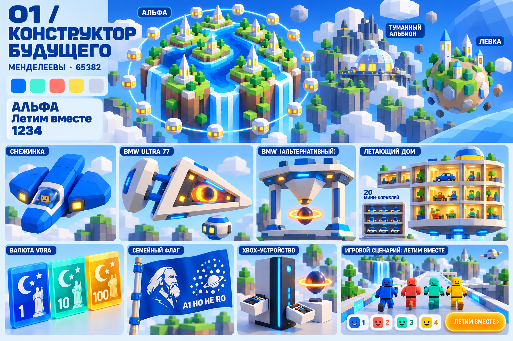
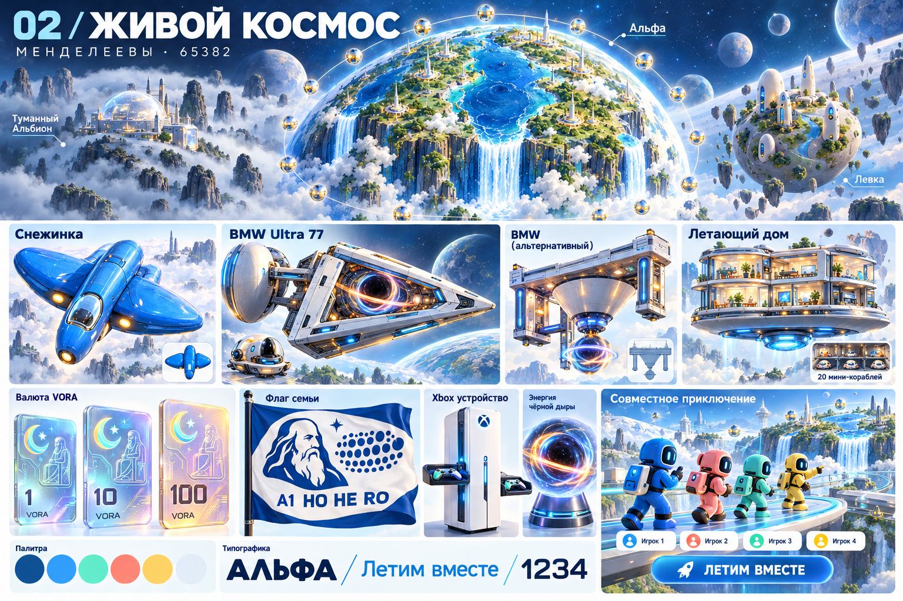
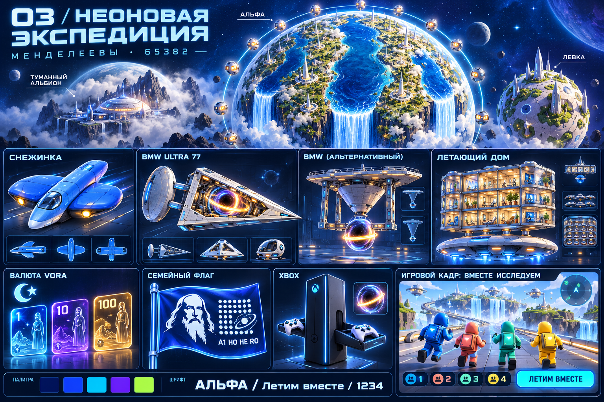

# Три направления для 65382 года

Это **варианты для выбора**, не массовая замена иллюстраций. Дизайны кораблей и планет остаются узнаваемыми; меняются материалы, степень детализации, цвет, шрифты и интерфейс. Левка включена во все три варианта.

| Вариант | Характер | Шрифт-кандидат | ВОРА и флаг | Игровой мир |
|---|---|---|---|---|
| 01. Конструктор будущего | Крупные модульные формы, матовый цвет, ближе всего к Roblox | Rubik: плотные заголовки, обычный текст без засечек | Цветные кредитные чипы; плоский графический флаг | Простые объёмные персонажи и платформы |
| 02. Живой космос | Округлые формы, светлая керамика, стекло, вода и зелень | Golos Text: ясный текст и выразительные жирные заголовки | Полупрозрачные карты; силуэт Менделеева вместо старинной гравюры | Мягкие формы, заметные игроки, светлые уровни |
| 03. Неоновая экспедиция | Тёмный космос, светящиеся контуры, более аркадное настроение | Exo 2 для заголовков, Golos Text для текста | Голографические карты и светящийся флаг | Контрастные платформы и навигация |

Моя рекомендация для обсуждения: **02 как основа**, а простоту персонажей и читаемость игрового уровня взять из **01**. Это сохраняет понравившиеся корабли и Альфу, но делает мир современным и удобным для семейной игры. Можно выбрать чистый вариант или конкретные части разных вариантов.

На досках шрифт — графический образец, а не точная отрисовка названной гарнитуры. Реальные кандидаты: [Rubik](https://github.com/google/fonts/tree/main/ofl/rubik), [Golos Text](https://github.com/google/fonts/tree/main/ofl/golostext), [Exo 2](https://github.com/google/fonts/tree/main/ofl/exo2).

Символы, числа и количество декоративных элементов в концептах служат эскизом. При финальной подготовке сохраняем канон: 14 шаров Альфы, 20 мини-кораблей, 125 планет, A1/HO/HE/RO и кириллическое имя ВОРА (латинское VORA на части эскизов — не переименование). Игровой кадр — макет, не готовая игра.

## 01. Конструктор будущего

## 02. Живой космос

## 03. Неоновая экспедиция

[Промпты imagegen](промпты.json) · [План игры и размещения](../../ПЛАН-ИГРЫ-И-РАЗМЕЩЕНИЯ.md).

## Дополнение: Frieze London

Добавлен вариант 04 — [Мастерская будущего](04-мастерская-будущего.png). [Исследование и источники](FRIEZE.md), [промпт встроенного imagegen](промпт-04.json). Все четыре варианта остаются предложениями для выбора.
