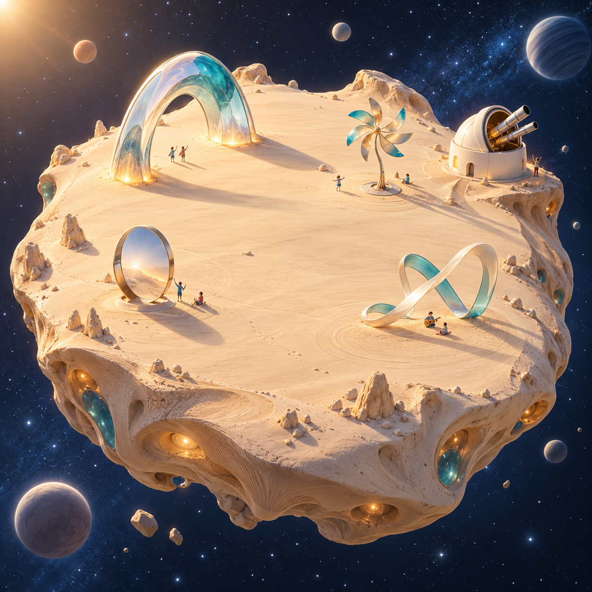

# Art Planet

Вид: планета · Добавлено: 19 октября 2026 года

## Что уже известно

- Art Planet наблюдает за другими планетами и тем, что происходит в мире.
- Её жители всё время придумывают искусство.
- Ландшафт похож на песчаную плайю: широкое открытое пространство с несколькими арт-объектами.
- На планете одна обсерватория с несколькими телескопами.

## Иллюстрация

## Ещё придумаем

- Как называются обсерватория и арт-объекты?
- Какие ещё устройства для наблюдения придумает семья?
- Кто живёт на Art Planet и входит ли она в 125 обитаемых планет?
