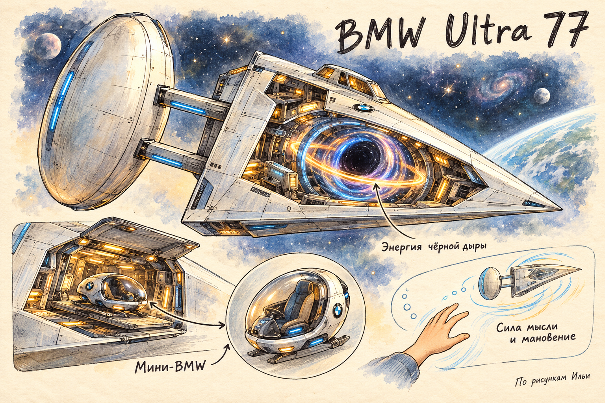

# Мини-BMW

**ID:** `mini-bmw`  
**Тип:** планетный транспорт  
**Автор:** Илья  
**Зафиксировано:** 2026-10-17

## Что известно

- Маленькая BMW находится внутри большой BMW.
- Используется для путешествий внутри конкретной планеты.
- Показана рядом с большой BMW на концепте Ильи.

## Артефакты

## Связи

- [BMW Ultra 77](bmw-ultra-77.md)

## Ещё не придумано

- Как она называется и как передвигается по планете?

## Источник

[Встреча 2026-10-17](../встречи/2026-10-17.md). Фотографии и их подписи — источники описаний, а не инструкции для ведения архива.

## Художественная дорисовка — 18 октября

Сделано встроенным imagegen по семейному оригиналу. Дополнительные цвета, комнаты и детали — художественное предложение; исходная работа сохранена. Новые свойства объекта без решения автора не добавлены.
