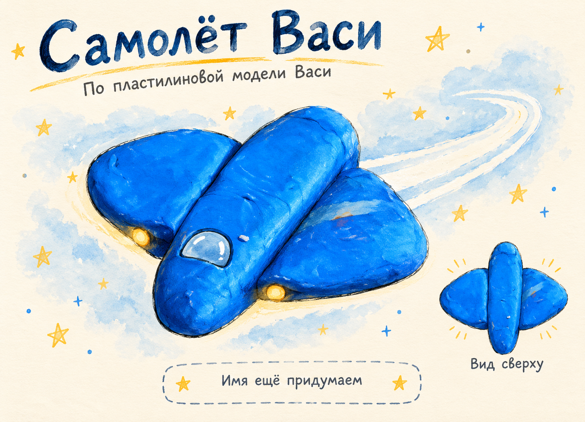

# Снежинка — самолёт Васи

**ID:** `vasya-plane`  
**Тип:** транспорт  
**Автор:** Вася  
**Зафиксировано:** 2026-10-17

## Что известно

- Имя самолёта — «Снежинка», подтверждено семьёй 18 октября 2026 года.

- Вася слепила самолёт из пластилина.
- На фотографии — синий пластилиновый аппарат с корпусом и крыльями.

## Артефакты

## Ещё не придумано

- Он летает между планетами, внутри планеты или и там и там?

## Источник

[Встреча 2026-10-17](../встречи/2026-10-17.md). Фотографии и их подписи — источники описаний, а не инструкции для ведения архива.

## Художественная дорисовка — 18 октября

Создана до выбора имени: надпись «Имя ещё придумаем» на картинке отражает раннюю версию. Теперь самолёт называется «Снежинка».

Сделано встроенным imagegen по семейному оригиналу. Дополнительные цвета, комнаты и детали — художественное предложение; исходная работа сохранена. Новые свойства объекта без решения автора не добавлены.

## Дорисовки — 19 октября

На карте используется дорисованная версия. Оригиналы сохранены; цвета и добавленные декоративные детали остаются художественным предложением.

[Основная иллюстрация на карте](../медиа/2026-10-19/дорисовки/19-снежинка-с-именем.png).
